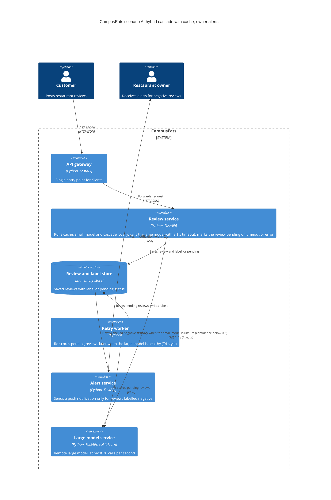

# Task 4: Deployment topologies and trade-offs

**Name / ชื่อ:** Piranat Wadlom

**Student ID / รหัสนิสิต:** 6732031621

This is **individual work**: each student completes and submits their own copy, in their own fork.

*งานนี้เป็น**งานเดี่ยว** นิสิตแต่ละคนทำและส่งงานของตัวเอง ใน fork ของตัวเอง*

**Scenario (A, B or C) / Scenario ที่เลือก:** A (Owner alerts)

Choose **one** scenario below. If the last digit of your student ID is odd, take A or B; if it is even, take B or C. Use your measurements from Tutorial 6 as evidence: cite run names from `results/runs.csv`. Answer in Thai or English.

เลือก scenario **หนึ่ง** ข้อด้านล่าง ถ้าเลขตัวสุดท้ายของรหัสนิสิตเป็นเลขคี่ ให้เลือก A หรือ B ถ้าเป็นเลขคู่ ให้เลือก B หรือ C ใช้ผลการวัดจาก tutorial ที่ทำไปเป็นข้อมูลอ้างอิง โดยอ้างชื่อ run จาก `results/runs.csv` จะตอบเป็นภาษาไทยหรือภาษาอังกฤษก็ได้

Facts that hold in every scenario / ข้อเท็จจริงที่ใช้กับทุก scenario:

- The large model serves at most **20 calls per second** (4 calls at once × about 200 ms each), and every call costs money.

  *large model รับได้สูงสุด **20 calls ต่อวินาที** (พร้อมกัน 4 calls × ประมาณ 200 ms ต่อ call) และทุก call มีค่าใช้จ่าย*
- The small model is fast and cheap enough to run anywhere, including inside the review service or on a kiosk, but it is much less accurate on its own.

  *small model เร็วและถูกพอที่จะรันที่ไหนก็ได้ รวมถึงภายใน review service หรือบน kiosk แต่ถ้าใช้ตัวเดียวจะแม่นน้อยกว่ามาก*

## Scenarios

**A. Owner alerts.** When a customer posts a negative review, the restaurant owner gets a push notification within **2 seconds**. At the lunch peak, CampusEats receives **40 reviews per second**. A missed alert is acceptable, but a wrong alert (for example, "your customer is unhappy" when they are happy) makes owners stop trusting alerts and, in the end, ignore them.

*เมื่อลูกค้าโพสต์รีวิวเชิงลบ เจ้าของร้านจะต้องได้รับ push notification ภายใน **2 วินาที** เวลาช่วงพีคตอนเที่ยง CampusEats ได้รับรีวิวจำนวน **40 รายการต่อวินาที** การพลาด alert ไปบ้างนั้นยอมรับได้ แต่ alert ที่ผิด (เช่น "ลูกค้าไม่พอใจ" ทั้งที่จริงๆ แล้วพอใจ) จะทำให้เจ้าของร้านไม่เชื่อถือและเลิกสนใจ alert ในที่สุด*

**B. Canteen kiosk.** A tablet in each canteen lets students leave a review on the spot. However, the canteen Wi-Fi is poor: the tablets lose their connection several times a day, for minutes at a time. The system must accept every review, even while a tablet is offline. Restaurant owners need the labels **by the end of the day**.

*มี tablet ในแต่ละโรงอาหารให้นิสิตรีวิวได้ทันที อย่างไรก็ดี การเชื่อมต่อ Wi-Fi ในโรงอาหารไม่ดี ทำให้ tablet หลุดการเชื่อมต่อวันละหลายครั้ง ครั้งละหลายนาที ระบบจะต้องรับรีวิวได้ทุกรายการแม้ขณะที่กำลัง offline อยู่ และเจ้าของร้านต้องการ label **ภายในสิ้นวัน***

**C. Weekly report.** Restaurant owners want a weekly sentiment report. Nothing in producing this report has to be real-time. **Accuracy matters most** and **cost must be minimal**.

*เจ้าของร้านต้องการรายงาน sentiment รายสัปดาห์ ไม่มีอะไรที่จะต้องทำแบบ real-time ในการออกรายงานนี้ ความแม่นยำ **(accuracy) สำคัญที่สุด** และ **ค่าใช้จ่ายต้องน้อยที่สุด***

## Topologies and patterns to choose from / Topology และ pattern ที่เลือกใช้ได้

| | Topology | Where the model runs / โมเดลรันที่ไหน |
|---|---|---|
| T1 | Model as a service, synchronous | Inference service, called for each review (today's baseline) *inference service ถูกเรียกทุกรีวิว (baseline ของวันนี้)* |
| T2 | Model as a library | Inside the review service, or on the device *ภายใน review service หรือบนอุปกรณ์* |
| T3 | Hybrid | Small model locally, large model as a remote service *small model รันในเครื่อง large model เป็น remote service* |
| T4 | Asynchronous / batch | Reviews are queued (broker, W10) or stored, and scored later in bulk *รีวิวถูกเข้าคิว (broker, W10) หรือเก็บไว้ แล้วติด label ทีหลังเป็นชุด* |

Combine one topology with any of the patterns from Tutorial 6: **fallback**, **cascade** and **cache**.

*เลือก topology หนึ่งแบบ แล้วผสมกับ pattern จาก Tutorial 6 ได้ตามต้องการ: **fallback**, **cascade** และ **cache***

## 1. Quality requirements

The three most important quality requirements for your scenario, each with a number where possible.

*quality requirements ที่สำคัญที่สุด 3 ข้อของ scenario ที่เลือก ระบุตัวเลขเมื่อทำได้*

| # | Quality | Requirement |
|---|---|---|
| 1 | Latency | The owner gets an alert for a negative review within 2 s (measured p95 of 557 ms at threshold 0.6, run t2-0.6) |
| 2 | Accuracy / trust | Accuracy of at least 90% (QR3); a wrong alert is worse than a missed one, so no alert is sent for a review without a label |
| 3 | Capacity and cost | At the peak of 40 reviews per second, at most 20 large-model calls per second (QR5), and as few large calls as possible (QR4) |

## 2. Design / การออกแบบ

Your topology, the patterns you add, and a container-level diagram (C4 level 2). The C4 diagram must be written in Mermaid.

*topology ที่เลือก pattern ที่เพิ่ม และ diagram ระดับ container (C4 level 2) เขียนด้วย Mermaid*

## 3. Evidence / หลักฐาน

Which runs support your choice? Show the numbers and, for scenario A, the capacity arithmetic: how many large-model calls per second does your design need at the peak?

*run ไหนที่สนับสนุนการตัดสินใจของนิสิต ให้นิสิตแสดงตัวเลขประกอบ และสำหรับ scenario A ให้นิสิตแสดงการคำนวณ capacity ด้วย เพื่อแสดงว่าในช่วงพีคนั้น design ของนิสิตต้องใช้ large model กี่ calls ต่อวินาที*

| Run | What it shows / แสดงอะไร |
|---|---|
| t2-0.6 | Cascade at threshold 0.6: accuracy 91.5% (meets QR3), p95 557 ms (within the 2 s alert limit), and only 38% of reviews reach the large model |
| t2-0.7 | At threshold 0.7, 53% of reviews reach the large model, which is too many for the 20 calls per second limit at the peak |
| t3-cache | Cascade at 0.7 with the cache on: cache hits 35%, and large calls drop to 38% (from 53% in t2-0.7) |
| t1-before, t1-after | Fallback: with 10% of large calls hanging, errors went from 19 to 0 and 25 reviews became pending instead of failing |

Capacity arithmetic at the peak of 40 reviews per second (the large model handles at most 20 calls per second):

- Calling the large model for every review (T1, run t0-large with 100% large calls): 40 x 1.00 = 40 calls per second, twice the limit.
- Cascade at 0.6 (t2-0.6, 38%): 40 x 0.38 = 15.2 calls per second, within the limit.
- Cascade at 0.7 (t2-0.7, 53%): 40 x 0.53 = 21.2 calls per second, over the limit.
- Cascade at 0.7 with the cache (t3-cache, 38%): 40 x 0.38 = 15.2 calls per second, within the limit. The cache hit rate of 35% was measured on the load-test reviews, so the real rate may differ.

## 4. ADR

Use the ADR format from W5.

*ใช้รูปแบบ ADR จาก W5*

**Title:** Hybrid cascade with cache for owner alerts

**Status:** Proposed

**Context:** Owners must get an alert for a negative review within 2 s, and at the lunch peak 40 reviews arrive per second, but the large model handles at most 20 calls per second and every call costs money. Wrong alerts make owners stop trusting alerts.

**Decision:** Use T3 (hybrid): the small model runs locally in the review service, with a cascade at threshold 0.6, a prediction cache, and a 1 s timeout with fallback to pending. The small model answers fast and does not use up the large model's quota; the large model is called only for the roughly 38% of reviews the small model is unsure about, about 15 calls per second at the peak (run t2-0.6). An alert is sent only for reviews that have a negative label, never for pending ones.

**Consequences:**
- Positive: Large-model load stays under the 20 calls per second limit (15.2 at the peak), p95 is 557 ms (within the 2 s alert limit), and a hanging large model no longer breaks posting (errors 19 to 0 in t1-after).
- Negative: The small model can be confidently wrong (for example "The pad thai looked cold but it tasted excellent." gets negative at 0.68), which causes some false alerts, and accuracy of 91.5% is only 1.5 points above the 90% limit. Pending reviews get no alert until they are re-scored.

**Alternatives considered:** at least one topology you rejected, and why.

*อย่างน้อยหนึ่ง topology ที่ไม่เลือก และเหตุผล*

> T1 (model as a service, called for every review) was rejected. It needs 40 large-model calls per second at the peak, twice the 20 per second limit, and if the large model goes down, alerts stop completely.
